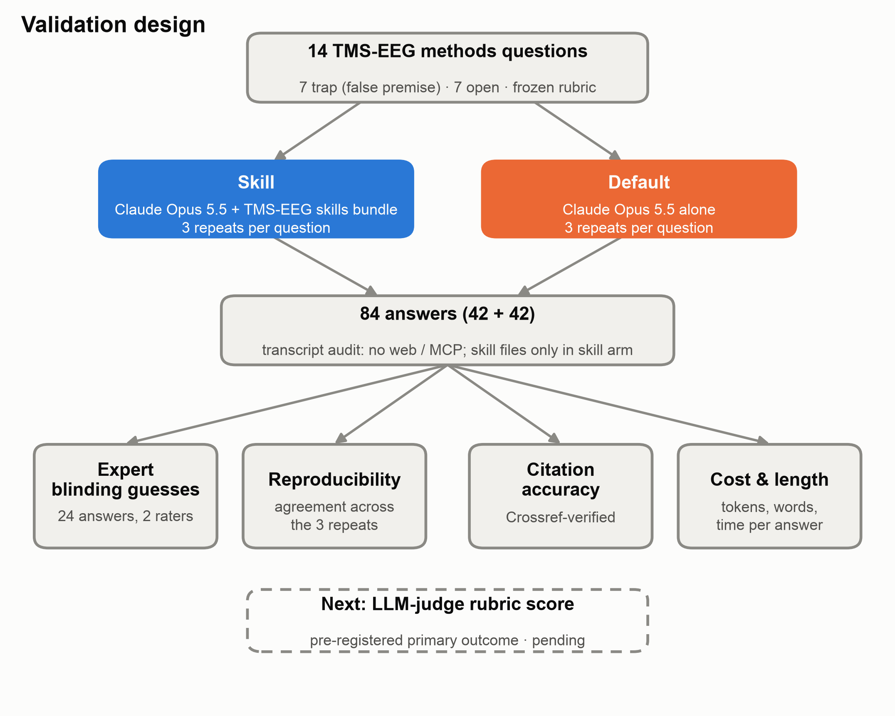
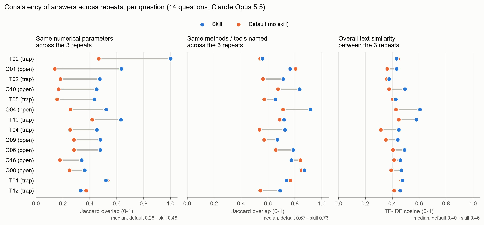
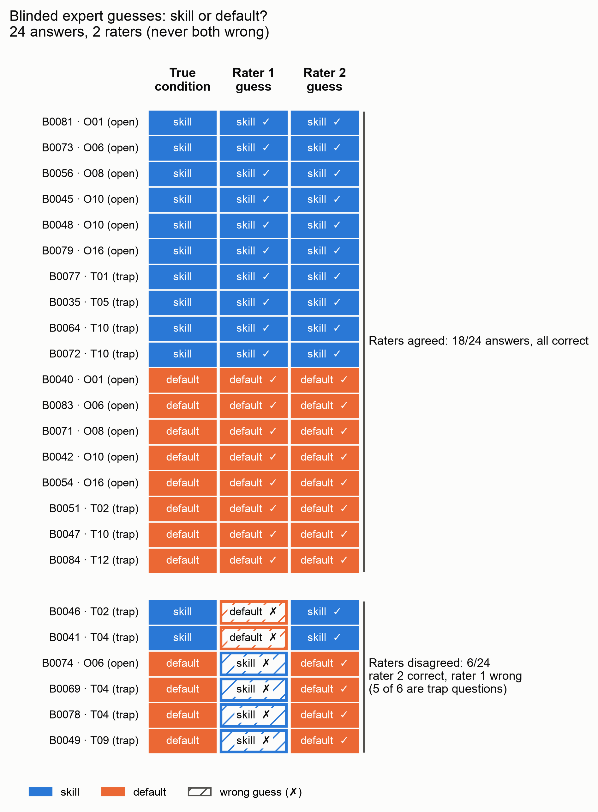
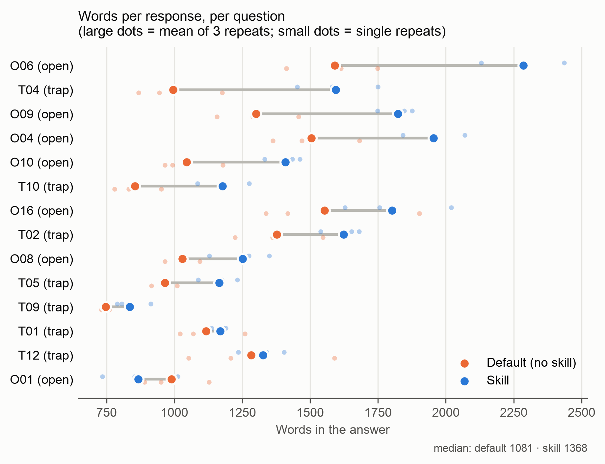

# Validation of the TMS-EEG skills bundle

A preliminary validation comparing answers of Claude Opus 5.5 **with** the TMS-EEG skills bundle (skill) and **without** it (default). It was run in October 2026 in response to peer review.

**Main finding:** with the skills, repeated answers to the same question converge on the same concrete, literature-anchored recommendations. Without the skills, the model gives a different protocol each time it is asked. This comes at a moderate cost: answers are ~20% longer and use ~1.5–2× more tokens.

## Design

- **14 TMS-EEG methods questions** (`questions_and_answers/questions.md`):
  - 7 *trap* questions whose premise contains a common methodological error, e.g. dosing DLPFC at a fixed % of resting motor threshold, or applying the PCI-LZ cutoff 0.31 to PCIst;
  - 7 *open* expert questions;
  - half target the experiment-planning skill, half the preprocessing skill.
- **Two conditions**, same model (Claude Opus 5.5):
  - *skill*: the agent reads the skills bundle (pinned at commit `021b4fb`);
  - *default*: no bundle.
- **Repeats:** each question was answered 3 times per condition, giving 84 answers (`questions_and_answers/answers/`, index in `answers_index.csv`).
- **Frozen inputs:** questions, rubric and prompt templates were frozen before any answer was generated.
- **Audit:** every agent transcript was checked. No web search, web fetch or external database tools were used in either condition. Skill files were read only in the skill condition. Two runs that broke the tool rules were discarded and re-run.

## Results

### 1. Reproducibility across repeats

For each question and condition, the three repeats were compared pairwise. Measures: overlap (Jaccard) of the numerical parameters they recommend, overlap of the methods/tools they name, and overall text similarity. Conditions were then compared per question (n = 14, Wilcoxon signed-rank test).

| Median per question | Skill | Default | Skill higher | p |
|---|---|---|---|---|
| Same numerical parameters across repeats (Jaccard) | **0.48** | 0.26 | 12/14 | 0.001 |
| Same methods/tools named (Jaccard) | 0.73 | 0.67 | 11/14 | 0.013 |
| Text similarity between repeats (TF-IDF cosine) | 0.46 | 0.40 | 13/14 | <0.001 |
| Variation in answer length (CV) | 7% | 11% | 4/14 | 0.017 |
| Numerical parameters per answer | 9.7 | 8.2 | 7/14 | 0.80 |

Skill answers do not contain more numbers; they repeat the same ones. Example, **choosing stimulation intensity for DLPFC (O01)**:
- *Skill:* all three answers gave the same procedure. RMT serves only as a starting reference; intensity is then titrated at the target with 10–30-trial online averages to an early local response of ~8–10 µV within 8–50 ms, with muscle artifact beyond ~4 ms as the upper limit.
- *Default:* the three answers shared no parameter, proposing 110% RMT, 120–130% RMT, 90–100% RMT or 70–120 V/m in different runs.

More examples (masking, ICA, PCIst, and the two questions without a gain): [`citations_and_reproducibility/EXAMPLES.md`](citations_and_reproducibility/EXAMPLES.md).

### 2. Blinded expert identification

Two co-authors received 24 answers without condition labels (stratified by condition and question type) and guessed for each whether it came from the skill or the default condition.

| Rater | Correct / 24 | Accuracy (95% CI) | Binomial p vs 50% |
|---|---|---|---|
| Rater 1 | 18 | 0.75 (0.55–0.88) | 0.023 |
| Rater 2 | 24 | 1.00 (0.86–1.00) | <0.001 |

- The raters agreed on 18 answers, and all of those guesses were correct.
- The 6 disagreements were mostly trap questions, where default answers also often rejected the false premise.
- Experts can recognise skill-conditioned answers. This shows the answers differ; on its own it does not show they are better.

### 3. Citation accuracy

All author–year citations (199 instances, 42 distinct papers) were checked against Crossref. Every automated miss was re-checked by targeted lookup.

| | Skill | Default |
|---|---|---|
| Answers containing citations | 15/42 | 26/42 |
| Citations per answer (mean) | 0.9 | 3.8 |
| Cited papers that exist | 38/38 | 161/161 |
| Full references with a detail error (wrong year / inaccurate title) | — (none given) | 3/45 (6.7%) |

**No fabricated papers in either condition.** Skill answers cite less often and only by author and year, drawing on the verified sources of the skill cards.

### 4. Cost and length

| Per response (median per question) | Skill | Default | Ratio |
|---|---|---|---|
| Words in the answer | 1,368 | 1,081 | 1.21× |
| Output tokens | 6,015 | 3,900 | 1.5× |
| Newly processed input tokens | 49,371 | 25,556 | 1.8× |
| Total processed tokens (incl. cached re-reads) | 453,935 | 111,417 | 4.1× |
| Model turns | 7 | 2 | 3.5× |
| Time per response | 88 s | 64 s | 1.4× |

All differences p ≤ 0.011 (Wilcoxon, n = 14 questions). The extra cost comes from the agent reading ~13 skill files over ~7 turns. Times were measured under parallel execution and include queueing; compare them between conditions rather than as absolute latency. Details: [`tokens_and_length/README.md`](tokens_and_length/README.md).

## Limitations

- **Single model** (Claude Opus 5.5); results may differ for other models or agents.
- **Consistency is not correctness.** These analyses show that skill answers are more reproducible and anchored to the same sources, not that every recommendation is right. A rubric-based scoring of answer quality against expert consensus is the next step.
- **Exploratory analyses:** reproducibility, citation and cost analyses were defined after the answers were collected.
- **Rater independence:** the two blinded raters are co-authors. Their rubric score sheets were not independent of each other and are not reported; only their independent condition guesses are.
- **Default arm exposure:** default agents could see the skills' names and one-line descriptions in the agent's tool list, though not their content.
- **Citation check scope:** it verifies that cited papers exist, not that they support the attached claim.

## Folder contents

| Folder | Contents |
|---|---|
| `questions_and_answers/` | The 14 questions and all 84 answers, labelled by condition in `answers_index.csv` (repeat, words, tokens, skill files read, audit status) |
| `citations_and_reproducibility/` | Citation verification tables (with Crossref evidence), reproducibility per question and summary, worked examples, figure, analysis scripts |
| `human_blinding_guesses/` | Each rater's guesses, guesses matched to the true condition, summary statistics, figure |
| `tokens_and_length/` | Tokens, words, model turns and time per answer, paired summary, figure |

The scripts in `citations_and_reproducibility/scripts/` were run in the original analysis project. They expect its file layout (answers in `runs/`, run log in `runs_log.csv`) and are included for transparency.
